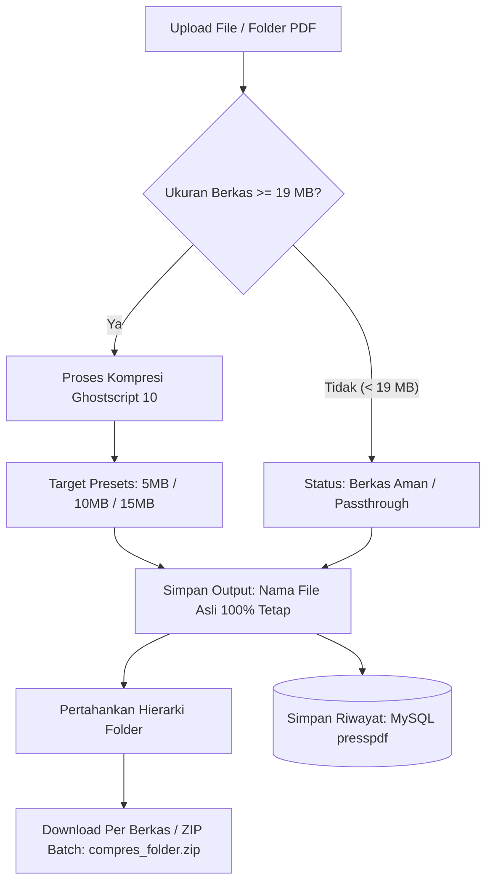

# 📄 PressPDF - Smart Batch PDF Compression Studio

<p align="center">
  
  
  
  
  
  
</p>

<p align="center">
  <strong>Solusi Kompresi PDF Skala Besar: Cepat, Presisi, Kualitas Terjaga &amp; 100% Aman untuk Berkas Klaim BPJS Kesehatan &amp; Arsip Instansi.</strong>
</p>

---

## 📌 Sekilas Tentang PressPDF

**PressPDF** adalah aplikasi web modern berbasis Laravel dan native Ghostscript 10 yang dirancang khusus untuk memecahkan tantangan kompresi dokumen massal pada instansi medis, rumah sakit, dan perkantoran.

Khususnya pada verifikasi berkas **E-Klaim BPJS Kesehatan** dan arsip digital, sistem mewajibkan:
1. Batasan ukuran berkas maksimal tertentu (misal: di bawah **20 MB** atau **10 MB**).
2. **Nama berkas dan kode klaim unik tidak boleh berubah sama sekali** (agar pembacaan otomatis sistem casemix/SIMRS tetap sinkron).
3. **Struktur hierarki folder tidak boleh berantakan** saat dilakukan proses kompresi satu folder penuh.

PressPDF hadir menjawab kebutuhan tersebut secara otomatis, terkalibrasi, aman, dan tanpa mengubah integritas kode berkas asli.

---

## 🚀 Fitur Unggulan

### 1. ⚡ Ghostscript 10 Native Engine
Ditenagai mesin Ghostscript versi terbaru dengan multi-pass dynamic DPI downsampling dan optimasi font/vektor. Proses kompresi berjalan sangat cepat (~0.6 detik per file pada server multicore) dengan kualitas visual teks dan scan dokumen yang tetap tajam.

### 2. 🛡️ Smart Threshold Filter (Ambang Batas 19 MB)
- **Ukuran &ge; 19 MB**: Otomatis diproses dan dikompresi sesuai target ukuran yang dipilih.
- **Ukuran &lt; 19 MB**: Otomatis diloloskan (*Safe Direct Passthrough*) tanpa penurunan kualitas ataupun kompresi berulang yang membuang waktu.

### 3. 🎯 Target Presets Terkalibrasi
Pilih target ukuran dokumen dengan sekali klik:
- **5 MB** – Kompresi agresif untuk pengiriman email & sistem kuota ketat.
- **10 MB** – Keseimbangan optimal untuk portal berkas dan klaim digital.
- **15 MB** – Kualitas maksimal di bawah batas portal BPJS 20 MB.
- **Custom Slider (1.0 – 19.0 MB)** – Fleksibilitas menentukan target megabyte sesuai kebutuhan spesifik.

### 4. 🔒 100% Preservasi Nama Berkas & Struktur Folder
- Nama setiap dokumen PDF **tetap utuh 100%** persis seperti aslinya.
- Mendukung fitur **Upload Folder** (`webkitdirectory`).
- Seluruh subfolder tetap dipertahankan posisinya.
- Hasil batch diunduh dalam bentuk file ZIP dengan penamaan folder luar berawalan `compres_` (contoh: `compres_Klaim_Oktober_2026.zip`).

### 5. 🎨 Antarmuka Modern & Ramah Pengguna
- **Tema Gelap & Terang (Dark / Light Mode)** yang nyaman di mata.
- Status progres interaktif per berkas secara *real-time*.
- Ringkasan statistik penghematan memori (Total Berkas, Berkas Terkompresi, Berkas Aman, dan % Efisiensi Ruang).
- Tabel hasil kompresi yang rapi dengan tombol unduh langsung per berkas atau unduh sekaligus dalam arsip ZIP.

### 6. 🗄️ Sinkronisasi Database MySQL Otomatis & Monitor Riwayat
- Setiap inputan berkas (baik berkas terkompresi maupun berkas aman passthrough) otomatis tercatat secara real-time ke tabel `compression_jobs` di database MySQL `presspdf`.
- Dilengkapi **Database Monitor Modal** interaktif di topbar aplikasi untuk memantau status berkas, ukuran awal, ukuran akhir, persentase penghematan, dan timestamp pemrosesan secara langsung.
- Dukungan endpoint API riwayat (`GET /history`) dengan format ringkasan data yang cepat dan terstruktur.

---

## 🔄 Alur Kerja Sistem (Pipeline)



---

## 💻 Kebutuhan Sistem (Prerequisites)

- **PHP**: `^8.1` atau `^8.2`
  - Ekstensi yang diperlukan: `ext-gd`, `ext-zip`, `ext-bcmath`, `ext-pcntl`, `ext-mbstring`, `ext-curl`
- **Ghostscript**: Versi 9.50+ atau **Ghostscript 10** (`gswin64c` di Windows atau `gs` di Linux)
- **Composer**: Versi 2.x
- **Web Server**: Nginx / Apache
- **Docker** *(Opsional, untuk containerization)*
- **Cloudflared** *(Opsional, untuk ekspos tunnel publik)*

---

## 🛠️ Panduan Instalasi Lokal (Quick Start)

### 1. Clone Repository
```bash
git clone https://github.com/yogskuyy/presspdf.git
cd presspdf
```

### 2. Install Dependensi PHP
```bash
composer install
```

### 3. Konfigurasi Environment (.env)
```bash
cp .env.example .env
php artisan key:generate
```

### 4. Buat Symlink Storage & Direktori Temp
```bash
php artisan storage:link
```

Pastikan folder storage memiliki izin tulis:
```bash
# Pada Linux / macOS:
chmod -R 775 storage bootstrap/cache
```

### 5. Konfigurasi `php.ini` (Penting untuk File PDF Besar)
Pastikan batas upload pada file konfigurasi PHP Anda mencukupi:
```ini
upload_max_filesize = 500M
post_max_size = 500M
memory_limit = 512M
max_execution_time = 600
```

### 6. Jalankan Server Pengembangan
```bash
php artisan serve
```
Akses aplikasi melalui browser di: `http://localhost:8000`

---

## 🌐 Publikasikan dengan Cloudflare Tunnel

Jika Anda ingin membuka akses aplikasi lokal ke internet secara aman tanpa port forwarding:
1. Pastikan `cloudflared` sudah terpasang.
2. Jalankan skrip:
   ```cmd
   start-online-tunnel.bat
   ```
3. Salin URL publik unik Cloudflare yang muncul di terminal (contoh: `https://xxxx.trycloudflare.com`).

---

## 🐳 Deployment Menggunakan Docker & Docker Compose

PressPDF telah dilengkapi dengan `Dockerfile` dan `docker-compose.yml` produksi berbasis Nginx, PHP 8.2-FPM, Supervisor, native Ghostscript 10, dan database MariaDB:

```bash
# 1-Langkah deploy lengkap (App + Ghostscript + Database)
docker compose up -d --build
```
Aplikasi siap diakses di `http://localhost` (port 80).

Atau jika ingin menjalankan container aplikasi tunggal:
```bash
# Build image Docker
docker build -t presspdf:latest .

# Jalankan container
docker run -d -p 8080:80 --name presspdf-app presspdf:latest
```

---

## 🐧 Deployment 1-Click ke VPS / Server Linux (Ubuntu 22.04 / 24.04 LTS)

Tersedia skrip otomasi [deploy-vps.sh](deploy-vps.sh) dan template Nginx [docker/nginx-vps.conf](docker/nginx-vps.conf) untuk deployment langsung di server Linux:
```bash
chmod +x deploy-vps.sh
sudo ./deploy-vps.sh
```
Skrip ini otomatis:
1. Memasang dependensi (Ghostscript, PHP 8.2 & ekstensi, Nginx, Composer).
2. Mengonfigurasi `php.ini` & Nginx untuk upload dokumen hingga 1 GB (1024M) dan batas waktu 900 detik.
3. Menyiapkan environment, folder penyimpanan, permission, migrasi database, dan *cache warm-up* Laravel.
4. Template virtual host Nginx siap pakai tersedia di `docker/nginx-vps.conf`.

---

## 📂 Struktur Direktori Utama

```
PressPDF/
├── app/
│   ├── Http/Controllers/
│   │   └── PdfCompressionController.php  # Logika upload, batching, manifest, & kompresi
│   └── Services/
│       └── PdfCompressionService.php     # Service deteksi & eksekusi Ghostscript 10
├── docker/
│   ├── nginx.conf                        # Konfigurasi Nginx produksi
│   ├── php.ini                           # Optimasi limit upload & timeout
│   └── supervisord.conf                  # Process manager Nginx & PHP-FPM
├── resources/views/pdf/
│   └── index.blade.php                   # Tampilan Studio UI responsif (Blade + CSS)
├── Dockerfile                            # Multi-stage production container
├── deploy-vps.sh                         # Skrip otomasi deployment Ubuntu VPS
├── start-online-tunnel.bat               # Shortcut Cloudflare Tunnel
└── README.md                             # Dokumentasi resmi proyek
```

---

## 📄 Lisensi

Proyek ini dirilis di bawah lisensi [MIT License](LICENSE). Bebas digunakan, dimodifikasi, dan didistribusikan untuk keperluan personal maupun instansi.

---

<p align="center">
  Dibuat dengan ❤️ untuk kemudahan pengelolaan dokumen instansi &amp; fasilitas kesehatan.
</p>
